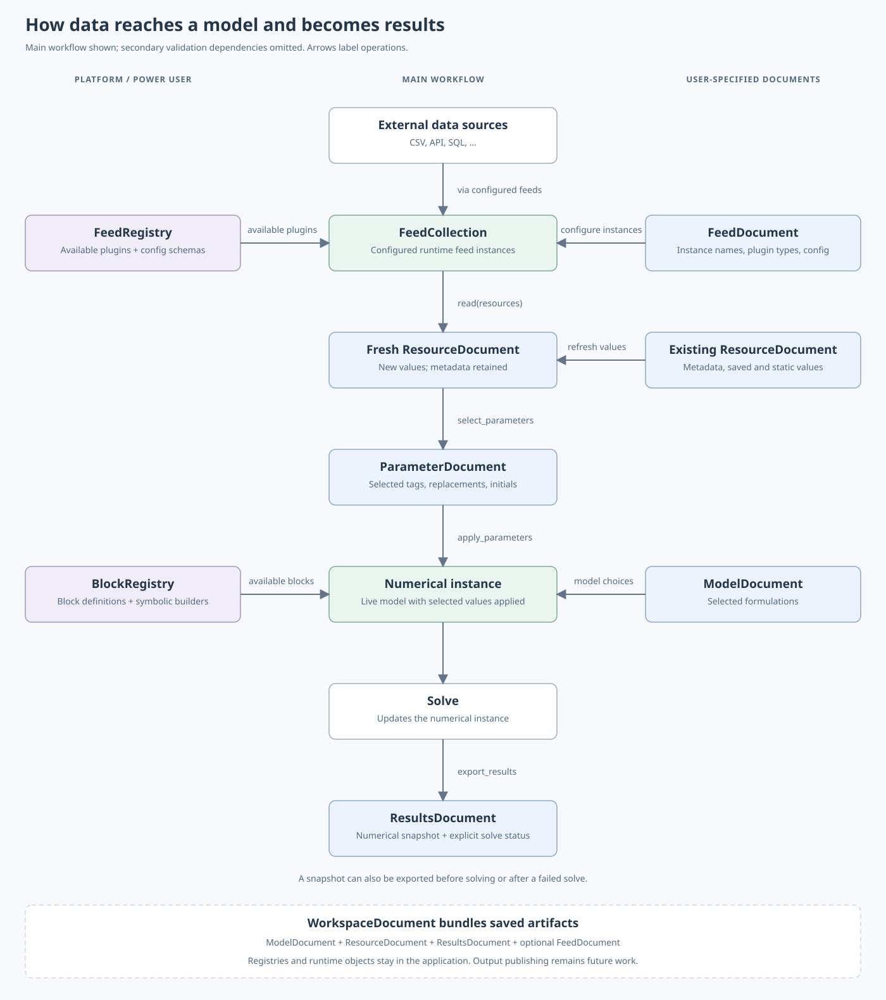

# Multifidelity model language

This project connects external data to reusable process models. It keeps available
evidence, parameter choices, live equations and recorded results separate, so a
case can be inspected and rerun with explicit configuration.

## Model and data flow

Read the diagram from top to bottom. Registries on the left provide application
capabilities; documents on the right configure a particular case.



[Open the full-size diagram](docs/data-exchange/data-flow.svg).

## Explore the block registry

The [model viewer](model-viewer/README.md) browses the JSON definitions in `src/multifidelity/model_language/blocks`. It shows model structures and formulations without constructing or solving a model.

## Examples

- [`examples/feeds/`](examples/feeds/): plugin registration, typed configuration, dynamic tags and resource acquisition.
- [`examples/model_language/`](examples/model_language/): formulation choices for reusable blocks.
- [`examples/custom_blocks/`](examples/custom_blocks/): custom Python symbolic providers integrated with JSON model definitions.
- [`examples/model_language/pipe_lumped.json`](examples/model_language/pipe_lumped.json): a pipe with cylindrical geometry and lumped thermal dynamics.
- [`examples/resources/`](examples/resources/): resource documents and record inspection.
- [`examples/parameters/`](examples/parameters/): applying operating parameters.
- [`examples/dynamic_tank/`](examples/dynamic_tank/): dynamic model construction and initial conditions.
- [`examples/steam_generating_heat_pump_system/`](examples/steam_generating_heat_pump_system/): one SGHP plant with independently selectable SGHP and PHNIX representations.

## Run

Install dependencies with `uv sync`. Run the model-language test suite with `uv run pytest -q`. For example, inspect required inputs or construct a model from the command line:

```bash
uv run python -m multifidelity.model_language valve examples/parameters/model_selection.json --required-inputs
```

Standard symbolic providers for Helmholtz properties, humid air, and compressor maps are available when registered explicitly. See the guide for their additional requirements and usage.

## Research direction

The [research ideas](research-ideas/README.md) describe future work on resources-directed parameters and model selection. The repository focuses on readable definitions, explicit terminology, and construction of symbolic blocks; construction does not imply numerical solution or validation.
