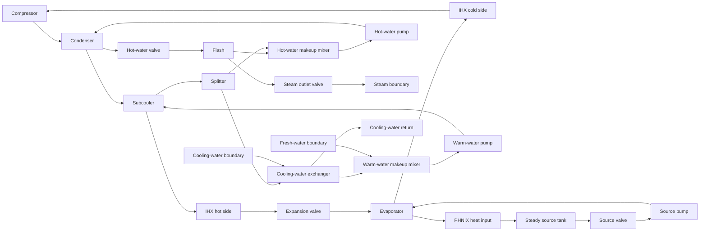

# Coupled SGHP fidelity-selection study

The source-loop experiment is retained as a controlled first example. This study
reconstructs the complete process topology of Ahuora's **SGHP with ihx – Flow
Correlations / Multi-steady state version**, revision 83, and investigates which
component representations permit a coupled steady-state solution.

The research question is **how much detailed physics can we retain while making
the flowsheet solvable, and what changes in the engineering outputs?** An
accepted coarse solution is an explicitly chosen approximation. It is not
initialization or validation of the all-high representation.

See [FULL_RESULTS.md](FULL_RESULTS.md) for numerical findings and the
[research direction](../../research-ideas/sghp-selection.md) for the broader aims.

## Reconstruction



The diagram shows equipment connectivity; exchanger hot/cold circuits remain
separate material streams. The archived [full snapshot](data/full_flowsheet_snapshot.json)
is the topology/specification evidence, with original names and IDs. The model
maps its material ports into ordinary expanded Pyomo Arcs. Recycle placeholders
are replaced by simultaneous closed-loop equations; they are not extra process
units. All nineteen process units and all captured material stream connections
are represented.

The refrigerant is n-butane, **not isobutane**, as in the captured compound
selection. IDAES PH Helmholtz states represent refrigerant evaporation and
condensation, liquid water, and wet steam. This phase-capable package is fixed
throughout a trial; property-fidelity switching remains a separate future
experiment. The earlier selectable liquid-water package is unchanged.

The compressor has fixed isentropic efficiency and calculated work. Three liquid
pumps conserve shaft work and energy. Two mixers, a homogeneous splitter, and a
flash separator close the water/makeup circuits. The flash retains the captured
99.9% phase recovery, so the steam outlet is wet: report both its total mass
flow and its actual vapor mass flow. Source-heater duty is calculated rather
than prescribed; the evaporator and other exchanger duties are coupled outputs.

## Fidelity choices

Every valve and exchanger has parent-owned states and shared physical quantities.
Use `unit.select_fidelity("low")` or `unit.select_fidelity("high")`.
Switching changes equations, preserving public values and fixed flags. The
flowsheet has zero DOF under each individually switched representation; private
states in inactive formulations do not constrain the selected model.

| Equipment | Low | High |
| --- | --- | --- |
| Condenser, subcooler, evaporator, cooling-water exchanger, IHX | Lumped overall balances with Chen's algebraic log-mean approximation | Four countercurrent mixed cells with phase-capable enthalpy states |
| Source valve | Shutoff-capable `m = K u deltaP` | Water-referenced squared-flow law, equal-percentage trim |
| Expansion and hot-water valves | Same basic law | Water-referenced squared-flow law, linear trim |
| Steam outlet valve | Same calibrated basic law | Unchoked pressure-squared relation with inlet-temperature correction |

The high exchanger uses the two cell outlet temperatures for local heat
transfer. This implicit mixed-cell closure avoids the oscillatory temperature
profiles that midpoint integration can produce at large cell NTU. It is still
a finite discretization, **not a mesh-independent truth model**. The original
midpoint `DistributedHX` remains available for existing examples.

The low exchanger uses `dTmean = (dT1*dT2*(dT1+dT2)/2)^(1/3)`.
Two bounded private terminal-difference variables keep fractional powers in their
domain. This formulation assumes positive hot-to-cold terminal differences;
it cannot represent heat-flow reversal. The high exchanger has signed duty and
can reverse. This is an intentional bounded research domain, not a guarantee
that every operating case admits an all-low solution.

Both exchanger formulations use the same UA and pressure drops. Area is fixed
to 1 m² so the numerical value of U equals UA; no geometry has been recovered
from the source evidence. `hot_pressure_drop[t]` and `cold_pressure_drop[t]`
are shared public variables, fixed to zero by default and specified consistently
in this case. The subcooler retains its captured refrigerant pressure drop.

The steam high model is a **relative fidelity**, not a validated industrial
steam-valve correlation. It omits choking and wet-steam corrections. Its
normalized law is

```text
(m/m0)^2 = (Cv/Cv0)^2 (u/u0)^2
           (Pin^2-Pout^2)/(Pin0^2-Pout0^2) T0/Tin
```

Coefficients are effective fitted parameters, not interchangeable with
manufacturer liquid Cv measurements. The expansion model likewise uses the
upstream-liquid hydraulic approximation; flashing occurs in the PH outlet,
without a flashing/choked-flow hydraulic correction.

## Specifications and calibration assumptions

This is a complete **topology reconstruction**, with a new rating/specification
problem. It does not replay every Ahuora measured-temperature target, controller,
MSS row, scaling choice, or initialization procedure.

- Refrigerant, hot-water circulation, warm-water circulation, and source flow
  targets come from the captured point. Compressor efficiency and pump
  efficiencies are retained; source-pump power is specified and hot-water pump
  power calculated. Warm-water pump power is zero as captured.
- The captured compressor discharge/suction, hot-water pump discharge,
  flash-feed, steam outlet, warm-water, and source-tank pressures anchor the
  respective circuits. Source-tank temperature is specified, its duty is zero,
  and PHNIX heat input is calculated. These pressure anchors limit how valve
  changes can affect the rest of this particular rating problem.
- Cooling-water flow, temperature, and pressure and fresh-water temperature and
  pressure are specified. Fresh-water flow, steam production, and the warm-water
  split fraction follow mass and energy balances.
- Mixer outlet pressure follows its main inlet. Higher-pressure makeup undergoes
  implicit isenthalpic letdown rather than a separately modeled valve.
- Redundant continuity equations in the refrigerant/source closed loops and one
  pressure equation in the zero-drop warm-water loop are omitted. DM checks the
  resulting active system; this does not establish numerical rank everywhere.
- Exchanger conductances are fitted **independently** using captured inlet states
  and each captured hot outlet temperature. The cold outlet follows conservation,
  rather than fixing a potentially inconsistent measured energy budget. This
  fitting is explicit and separate from trial solves.
- Valves are calibrated at the captured flow and pressure drop. The three
  formerly fully open valves use an assumed nominal opening of 0.7 to leave
  control range on either side; this is a new equipment assumption. The source
  valve retains its captured nominal opening and equal-percentage characteristic.

[full_calibration.json](data/full_calibration.json) records the fits and cold
outlet comparison. PH seed enthalpies are computed consistently from the local
EOS, including captured vapor fraction for two-phase streams. Small differences
from Ahuora's thermodynamic values remain. Agreement at a fitted operating point
is a reconstruction check, not independent validation.

## Algorithms and acceptance

`src/multifidelity/workflow.py` owns the generic search. It knows named fidelity
choices and solve outcomes, not valve or exchanger equations. Case-specific
acceptance, residual scaling, operating context, and structural groups stay in
this directory.

| Strategy | Procedure |
| --- | --- |
| All high / all low | Uniform baselines |
| Manual | Source valve low, eight other choices high |
| Progressive | Solve all low; upgrade one unit at a time, retaining successful changes |
| Failure driven | Start all high; simplify units in a declared fixed order until accepted |
| Residual guided | After failure, simplify the remaining high unit with the largest scaled equation residual |
| Structure guided | Simplify the structural group containing that residual-ranked unit |
| Operating context | Use all high at reference; prescribe the source valve low in the declared low-flow cases |
| Grouped refinement | Start all low; upgrade structurally coupled groups together, rolling back failures |

Dulmage–Mendelsohn decomposition checks determinacy. Strongly connected blocks
of the initial all-high matched equation graph provide equipment groups, held
fixed during each search; overlapping groups are
merged so a unit is switched once per group. Structural coupling does not prove
numerical causation. Likewise, a large residual at a failed iterate is a
candidate-selection hint, not identification of faulty physics.

Failed refinements restore the last accepted values and fidelity assignment.
Relaxation searches rank the failed point's residuals, then retry each new
assignment from the original guesses. This avoids propagating an arbitrarily
bad failed iterate and gives a reproducible restart policy. Every attempted
solve, including failures, is retained and charged to the algorithm.

Acceptance requires successful solver termination, small scaled equation and
bound residuals, mass/energy conservation, and heat transfer in the appropriate
direction. A negative IHX duty is allowed when terminal temperature differences
reverse consistently. Merely obtaining an IPOPT `optimal` status is insufficient.
The outcome is `all_high_solution`, `accepted_approximation`, or `failed`.

Compare steam outlet and dry-steam production, heating and steam COP, source heat
input, and all exchanger duties. Heating COP is `(Qcondenser+Qsubcooler)/Wtotal`;
steam COP is `msteam*(hsteam-hfresh)/Wtotal`. Total work includes compressor and
all pumps. These definitions remain identical across selected representations.
Prediction differences are only computed against an accepted all-high solution
at the same operating condition. Otherwise they remain null.

Four cases use identical equipment parameters: reference; 85% source flow;
60% source flow; and `low_demand`, which scales specified refrigerant/circulation/
cooling-water flows and source-pump power to 10%. The source-only reductions
retain nominal pump power and the other flow specifications. The low-demand
case retains UA, pressures, and boundary temperatures; steam production and
heat duties are calculated, not prescribed to 10%. It is a low-throughput proxy,
not an exact shutdown or a reconstructed plant load-control strategy.

A separate [control-range diagnostic](data/full_source_control_range.json)
rearranges the source-pump and detailed valve laws without solving. It confirms
that all three low-flow specifications require negative detailed valve openings.
This establishes a model-admissibility conflict independently of IPOPT failure;
switching to the basic law changes that assumption rather than recovering a
solution of the original detailed equation.

The perturbed start reduces free flow guesses to 70%, raises free enthalpies
by 10 kJ/kg, reverses the source-valve pressure drop with a 400 kPa suction
guess, and sets source opening to 0.1 (other valve openings to 0.8). The reference
start uses captured states. Solver limits and scaling are identical across
strategies: 80 iterations and 8 CPU seconds per attempt. Both limits and all
failed attempts count toward the observed outcome and cost.

The greedy algorithms are order dependent and do not prove that their final
assignment maximizes detailed models. This initial experiment compares
feasibility and retained representations; output-error budgets do not yet drive
selection. IDAES unit/recycle initialization is not benchmarked here: each
trial starts from identical documented guesses and directly solves the full
coupled equations, without hidden unit solves.

## Reproduce

IPOPT and IDAES Helmholtz extensions are required. n-Butane parameter files are
bundled with [provenance](../../src/multifidelity/property_models/data/README.md).
IDAES's process-wide data path is merged in a temporary directory without
modifying the installed package. Other built-in fluids remain registered.

```bash
# Explicit fitting; changes the saved calibration inputs.
uv run python -m case_studies.sghp.full_flowsheet --calibrate

# Default grid: four cases, two starts, nine strategies.
uv run python -m case_studies.sghp.full_experiments \
  --baseline-summary case_studies/sghp/full_baseline_summary.json

# Solver-free source-valve control-range check.
uv run python -m case_studies.sghp.control_range

# A single investigation.
uv run python -m case_studies.sghp.full_experiments \
  --case low_demand --start reference --strategy failure_driven

uv run pytest tests/test_full_sghp.py -q
```

Logs and detailed working results go under ignored `results/full/`. The reviewed
[baseline](full_baseline_summary.json) is tracked separately. Regenerating
calibration or changing cell count defines a new numerical study; do not compare
such trials as if only the selection algorithm changed.
