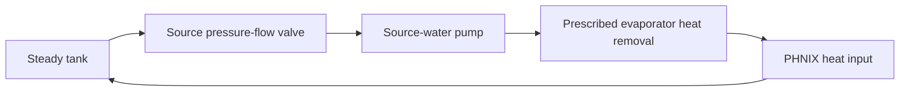

# SGHP source-loop case study

Research question: can a simpler valve pressure–flow formulation help initialize
the detailed hydraulic model, and can a residual criterion avoid unnecessary
refinement? This first experiment reconstructs the source-water loop rather
than the complete SGHP. See [the results and conclusions](RESULTS.md).

## Repository responsibilities

```text
src/multifidelity/
    base.py                      # Generic fidelity protocol, assembly, selection
    property_models/             # Shared-state water formulations
    unit_models/
        streams.py               # State/port and stream-balance helpers
        heat_exchanger/          # Shared interface, lumped and distributed physics
        valve/                   # Shared interface, linear and pressure-flow physics
        pump/                    # Fixed-efficiency liquid pump
        thermal_conditioner/     # Zero-pressure-drop heater/cooler
case_studies/sghp/
    data/reference_case.json     # Specifications and starts, with units/provenance
    data/ahuora_evidence.json    # Targeted current snapshot and immutable run outputs
    source_loop.py               # Case-specific topology and specifications
    experiments.py               # Explicit solve sequences and measurements
    baseline_summary.json        # Reviewed numerical results
    RESULTS.md                   # Interpretation and limitations
    results/                     # Ignored generated logs and full results
```

The public imports from `multifidelity` remain available. Generic workflow code
does not import model-library interfaces. Each equipment folder owns its model,
shared interface where needed, and fidelity builders. Case data and experimental
policies belong here rather than inside the reusable model libraries.

## Physical reconstruction



The tank is represented as an adiabatic pass-through, the evaporator by fixed
heat removal, and the PHNIX heater by adjustable heat input. The pump has fixed
shaft power and efficiency, with fluid work based on outlet volume flow as in
the inspected Ahuora implementation. The valve is adiabatic with common material
and energy balances. Ports and ordinary expanded Pyomo Arcs close the circuit.
One redundant continuity equation in this single-stream closed loop is omitted;
the remaining equations still enforce equal flow throughout the circuit.

Specifications are mass-flow target, tank outlet temperature and absolute
pressure, pump shaft power and efficiency, evaporator heat removal, tank duty
zero, and valve coefficient. Heater duty and valve opening are calculated. The
absolute pressure anchor is an explicit assumption of this reduced experiment,
chosen from Run 27's state; it is not claimed to reproduce every historical
pressure specification. No full refrigerant cycle, IHX, flash circulation,
measured time series, or Ahuora initialization sequence is recreated yet.

## Valve formulations

The detailed liquid law is

```text
Q = m / rho
f(u) = alpha ** (u - 1)
Q² (rho / rho_water) = Cv² (Pin - Pout) f(u)²
```

The reference-water density is 999 kg/m³ and alpha is 100. Cv = 1 in the
recorded m³/h/√Pa display units becomes 1/3600 in m³/s/√Pa internally. The
coefficient remains a shared variable, fixed in these experiments. Neither
opening nor pressure is fixed by changing fidelity.

The simple formulation is the first-order Taylor approximation of the positive
mass-flow branch around the nominal point:

```text
m / m0 = 1 + (Cv - Cv0)/Cv0 + (deltaP - deltaP0)/(2 deltaP0)
           + (rho - rho0)/(2 rho0) + ln(alpha) (u - u0)
m0 = Cv0 f(u0) sqrt(deltaP0 rho0 rho_water)
```

It is affine in its hydraulic quantities; the complete loop can still be
nonlinear through pump and property equations. Both closures add one equation
per time point and use the same variables. The nonlinear residual is divided
by the nominal squared volume-flow/specific-gravity term for a dimensionless
comparison. The detailed constraint also uses this normalization, so this is
not a recreation of the remote solver's equation scaling.

## Controlled strategies

- **Direct:** solve the nonlinear valve formulation from the recorded start.
- **Staged:** solve the linear formulation, preserve all resulting values,
  switch to nonlinear, and solve again. Stop if the linear solve fails.
- **Selective:** solve linear, then upgrade only if the absolute normalized
  nonlinear residual exceeds 1e-3. Otherwise retain the approximation.

Every strategy constructs a fresh model with identical specifications and
starting guesses. There are no hidden unit/property initialization solves.
Four starts exercise near-reference values, reversed valve pressures, equal
pressures, and a wide-open valve. Four operating cases cover the reference,
20% higher flow, a lower pressure anchor, and a lower-flow control-range stress.
The full grid runs separately with linear water and Helmholtz water properties.
Temperature guesses use the tank target, reduced by 10 K after the evaporator;
both strategies use the same elementary constant-cp property guesses. These are
starting values only and do not change the selected property equations.

Direct/staged success requires the nonlinear block to be active, successful
termination, normalized nonlinear residual below 1e-6, positive pressure drop,
mass error below 1e-6 kg/s, and unit energy error below 1e-3 W. Selective
acceptance can retain a linear block at the looser 1e-3 nonlinear residual;
this is labeled separately from detailed validation. Engineering error is
checked against a separately solved detailed root at the same operating case.

Total iterations and solve wall time include every stage. Model construction
time is recorded separately. A diagnostic negative-opening relaxation is
excluded from strategy statistics; it checks whether a failed operating target
would require opening outside the physical [0,1] range. The chosen refinement
threshold is illustrative, not an established engineering error bound.

## Run

```bash
uv sync
uv run python -m case_studies.sghp.experiments
uv run pytest -q
```

The experiment needs IPOPT; Helmholtz cases additionally need IDAES extensions.
Without the Helmholtz library, the runner executes and records only linear-water
cases. Full results and individual solver logs go under `results/`. To explicitly
replace the checked numerical snapshot after reviewing a rerun:

```bash
uv run python -m case_studies.sghp.experiments \
  --baseline-summary case_studies/sghp/baseline_summary.json
```

Source evidence is kept separate from local experimental output. Run 24 and
Run 27 are useful failure/reference observations, but their full configurations
have not been demonstrated identical; they are not a controlled Ahuora A/B test.
